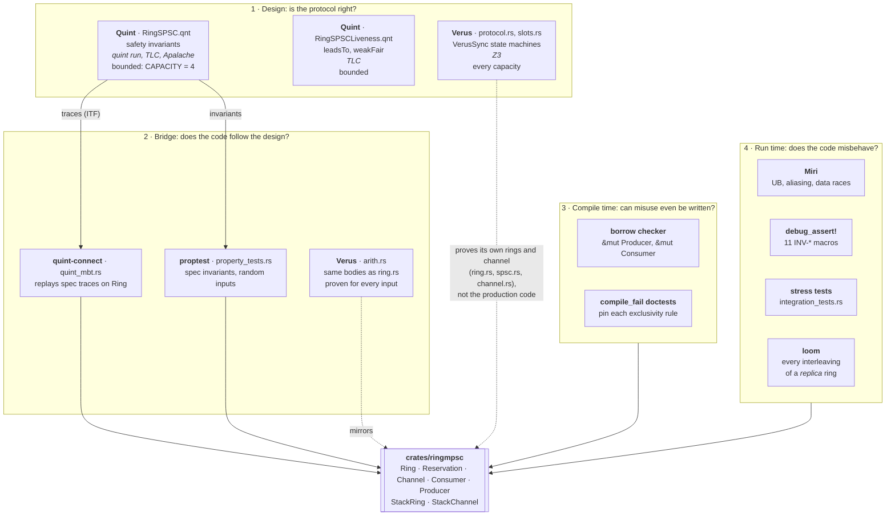
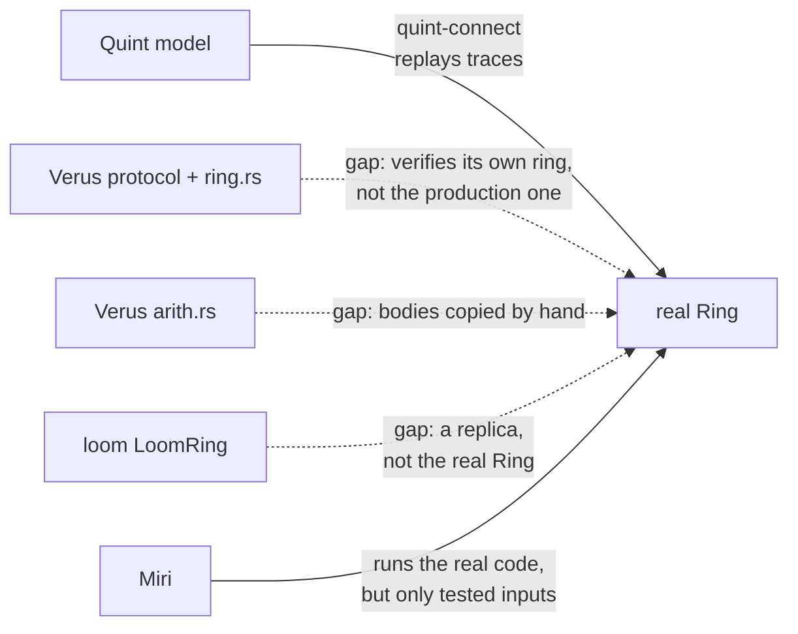

# Verification Architecture

How the verification tools in this workspace divide the work: what each one checks, what it checks it *against*, and where the gaps between them are.

No single tool covers everything. Quint checks the design but not the code. Miri checks the code but only on the inputs a test gives it. Verus proves properties for all inputs, but only of what it has a model of. Each layer below covers part of what the others miss.

## The layers

Solid arrows mean the tool checks that artifact directly. Dashed arrows mean the connection goes through a model or a manual mirror. That is where a gap can hide (see [Gaps](#gaps-between-the-layers)).

## What each tool answers

| Tool | Question it answers | Checks against | Scope | Proof or evidence? |
|---|---|---|---|---|
| **Quint**, `quint run` | Does a random walk of the protocol ever break an invariant? | `RingSPSC.qnt` | the model | evidence |
| **Quint** + TLC / Apalache | Does *any* reachable state break it? | `RingSPSC.qnt` | the model, `CAPACITY = 4`, `MAX_ITEMS = 8` | proof, for that bound |
| **Quint** liveness | If the consumer keeps running, does every item get consumed? | `RingSPSCLiveness.qnt` | the model, bounded | proof, for that bound |
| **Verus** protocol | Are the invariants inductive, so they hold for every capacity and history? | `protocol.rs` | the model, unbounded | proof |
| **Verus** arithmetic | Are masking, `len`, `space` and `contiguous` right for every input? | `arith.rs` (same bodies as `ring.rs`) | a copy of the code, unbounded | proof |
| **Verus** exec rings | Is a ring with the production design memory-safe and a correct FIFO for every input, and for every interleaving of a producer and a consumer thread? | `verus/.../ring.rs` (single-threaded), `spsc.rs` (two threads, SeqCst atomics, batches) and `channel.rs` (MPSC: registration and the consumer claim), on `slots.rs` | verified rings and channel, not the production ones | proof |
| **quint-connect** | Does the real `Ring` do what the spec says, step by step? | spec traces replayed on `Ring<T>` | the real code | evidence |
| **proptest** | Do the spec's invariants hold on random operation sequences? | `Ring<T>`, `StackRing` | the real code | evidence |
| **borrow checker** | Can two producers, or two consumers, reach one ring at once? | the public API's signatures | the real code, all programs | proof, of exclusivity only |
| **compile_fail doctests** | Does each exclusivity rule stay enforced? | programs that must not compile | the real API | regression guard |
| **Miri** | Does this execution have UB: aliasing, uninitialized reads, data races? | the real code, per test | the real code, the inputs tested | evidence, precise |
| **loom** | Is there a thread interleaving where the orderings break? | `LoomRing`, a replica built on loom atomics | a model of the code | proof, for a small bound |
| **debug_assert!** | Did an invariant break in this run? | the real code, debug builds | the real code, the runs observed | evidence |
| **stress tests** | Does it survive many threads and many items? | `Channel` | the real code | evidence |
| **ringwal-sim** | Does the WAL keep acknowledged commits through faults and crashes? | `ringwal`, with simulated I/O | the WAL layer | evidence, reproducible |

## Coverage by concern

✅ covered · 🟡 partly covered · ⬜ not covered

| Concern | Quint | Verus | MBT / proptest | Borrow checker | Miri | loom | debug_assert |
|---|---|---|---|---|---|---|---|
| Protocol invariants (INV-SEQ, INV-INIT) | ✅ bounded | ✅ unbounded | ✅ | ⬜ | 🟡 | 🟡 | ✅ |
| Cache soundness (`cached_head`, `cached_tail`) | ✅ bounded ¹ | ✅ | 🟡 | ⬜ | 🟡 | ✅ | ⬜ |
| Index arithmetic, wrap-around | ⬜ | ✅ | 🟡 | ⬜ | 🟡 | ⬜ | 🟡 |
| Liveness (no stuck items) | ✅ bounded | ⬜ | ⬜ | ⬜ | ⬜ | ⬜ | ⬜ |
| One producer, one consumer per ring | 🟡 assumed | ✅ verified ring ⁴ | ⬜ | ✅ | ✅ repro | ⬜ | ⬜ |
| Memory orderings (`Acquire`/`Release`) | ⬜ | ⬜ ² | ⬜ | ⬜ | ✅ | ✅ replica | ⬜ |
| Aliasing (`&mut` uniqueness, retags) | ⬜ | ⬜ | ⬜ | 🟡 | ✅ | ⬜ | ⬜ |
| Uninitialized reads, double free | ⬜ | 🟡 ³ | ⬜ | ⬜ | ✅ | ⬜ | ⬜ |

1. Both models guard the producer by `cached_head`, which is what the code reads on the fast path, and carry the invariant `cached_head <= hd` (`cachesLag` in Quint, `caches_lag` in Verus). Quint checks it at the bound; Verus proves it for every capacity.
2. Verus treats atomics as sequentially consistent. That rules out reasoning about weaker orderings.
3. Proven for the verified rings in `verus/ringmpsc-verified`: `ring.rs` (#22, single-threaded) and `spsc.rs` (#23, a producer and a consumer thread). Their slots are `PCell`s whose `PointsTo` tokens live in the protocol, so every read needs an initialized token. Not the production `Ring`.
4. In `spsc.rs`, each side's protocol tokens exist once and the halves aren't `Clone`, so a second producer or consumer can't be created. In `channel.rs`, `register` hands each ring out at most once (a compare-and-swap withdraws its permission), and the consumer claim admits at most one `ChannelConsumer` (#25). The production crate enforces the same rules with `&mut` and the runtime `Consumer` claim (#12).

## Quint and Verus: the overlap

Both model the same SPSC protocol. They share the four cursors (`hd`/`head`, `tl`/`tail`, both caches), have one-to-one actions, guard the producer by `cached_head`, and carry the same safety invariants: bounded count, head never passes tail, and both caches lag. That is the only layer where they overlap, and there Verus is strictly stronger: it proves for every capacity what Quint checks at `CAPACITY = 4`.

| Only Quint | Only Verus |
|---|---|
| Liveness (`RingSPSCLiveness.qnt`) | The real `u64` arithmetic, with its wrap-around (`arith.rs`) |
| Conformance of the real code: `quint-connect` replays its traces on `Ring` | Batches, partial commits, abandoned reservations |
| Fast, readable counterexample traces from `quint run` | Slot disjointness and distinctness as proven properties |

Both models are maintained by hand, so they can drift. When they disagree on safety, the Verus proof is the authority.

## Gaps between the layers

| Gap | Risk | Mitigation |
|---|---|---|
| Verus verifies its own exec ring (`ring.rs`), not the production `Ring` | the production code drifts from the verified design | the verified ring follows the production design line by line; phase 7 (#26) runs the same tests on both and decides whether the verified ring replaces the production one |
| `arith.rs` copies `ring.rs` bodies by hand | the two drift apart | review both together; once the exec ring is verified, it calls the verified functions directly |
| loom tests `LoomRing`, not `Ring` | the replica's orderings differ from the real ones | keep `LoomRing` in sync with `ring.rs`, or run loom on `Ring` via a `cfg(loom)` atomics shim |
| Miri sees only the executions a test drives | a bug on an untested path | Miri runs targeted repros, and Verus covers the paths no test reaches |
| Quint compares unbounded integers | wrap-around bugs are invisible to it | Verus `arith.rs` checks the real `u64` arithmetic |

## Which tool caught which bug

| Issue | Bug | Surfaced by | Confirmed by | Guarded by |
|---|---|---|---|---|
| #5 | producer/consumer data race from whole-buffer retags | Miri (Tree Borrows) | Miri | `miri_overlap_test.rs` |
| #7 | one producer, two overlapping reservations | code review | Miri | `compile_fail` doctest on `Producer::reserve` |
| #13 | two consumers drain one ring: double free | code review, while planning the Verus model | Miri (both borrow models) | `Consumer` handle, `miri_double_consumer_test.rs`, `compile_fail` doctests |
| #14 | `Ring::advance(n)` past `tail` in release (and a wrapping `n` that moved `head` backwards in every build) | code review | Miri `--release` | `assert_head_not_past_tail!`, on in every profile; `should_panic` tests for `Ring` and `StackRing` |
| #15 | `StackRing::commit` publishes unwritten slots | code review | Miri | `commit` is `unsafe fn` on `StackRing` and `StackProducer`; `compile_fail` doctests |
| #17 | `readable()` returns unwritten slots after `consume_batch*` | **Verus**: the protocol needs `head < cached_tail` | Miri | Miri regression tests, a mixed-API property test against a FIFO model, and `arith::readable_avail` (the old logic fails its proof) |
| #32 | `Reservation::commit` publishes slots the caller never wrote (heap ring, safe code) | **Verus**: the batch protocol's `produce_end` needs an initialized token per published slot | Miri | `Reservation` counts writes and commits only that prefix (the verified design); Miri regression tests; a doctest that commit-without-write publishes nothing; a `compile_fail` doctest that the raw slots aren't reachable |

Every bug that reached code so far was UB that only Miri could *confirm*. But most were *found* by asking what the type system or the model would need to hold. #17 is the clearest case: no test reached it, the Quint model can't express it, and it surfaced only because the Verus proof wouldn't go through without an assumption the code didn't make. Once it was known, a property test that mixes the consumer APIs against a FIFO model found it in its first cases. That test is the guard now.

## Running each layer

| Layer | Command |
|---|---|
| Quint simulation | `quint run crates/ringmpsc/tla/RingSPSC.qnt --main=RingSPSC --invariant=safetyInvariant` |
| Quint exhaustive | `quint verify crates/ringmpsc/tla/RingSPSC.qnt --main=RingSPSC --invariant=safetyInvariant --backend=tlc` |
| Quint liveness | `quint verify crates/ringmpsc/tla/RingSPSCLiveness.qnt --main=RingSPSCLiveness --temporal=eventuallyConsumed --backend=tlc` |
| Model-based testing | `cargo test -p ringmpsc-rs --test quint_mbt --features quint-mbt --release` |
| proptest, stress, unit, doctests | `cargo test --workspace --release` |
| Miri | `cargo +nightly miri test -p ringmpsc-rs --test miri_tests` (also `miri_overlap_test`, `miri_double_consumer_test`; add `MIRIFLAGS="-Zmiri-tree-borrows"` for Tree Borrows) |
| loom | `cargo test -p ringmpsc-rs --features loom --test loom_tests --release` |
| Verus | `cd verus/ringmpsc-verified && cargo verus focus` (needs a Verus release on `PATH`; see its README) |
| WAL simulation | `cargo test -p ringwal-sim` |
